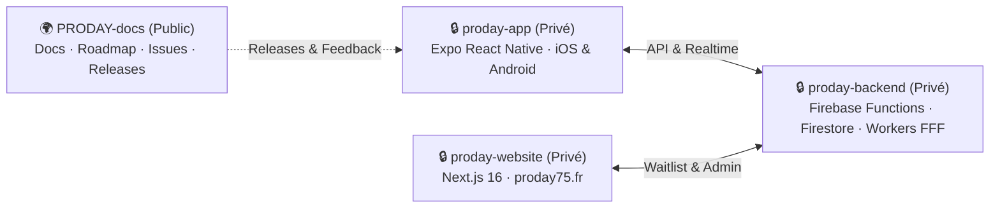

  

---

## ⚡ Une seule donnée football, trois pôles connectés

**ProDay** remplace les groupes WhatsApp éparpillés et les tableaux Excel par une infrastructure unifiée :

<table>
  <tr>
    <td width="33%" valign="top">
      <h3>🏛️ Pôle Club</h3>
      
<strong>Présidents & Secrétaires</strong>

      <ul>
        <li>Import & suivi des licences FFF</li>
        <li>Cotisations & certificats médicaux</li>
        <li>Planning des terrains & vestiaires</li>
        <li>Effectifs U7 à Seniors</li>
      </ul>
    </td>
    <td width="33%" valign="top">
      <h3>📋 Pôle Coach</h3>
      
<strong>Entraîneurs & Éducateurs</strong>

      <ul>
        <li>Tableau tactique & séances</li>
        <li>Convocations en 1 clic</li>
        <li>Feuilles de match & présences</li>
        <li>Suivi du temps de jeu</li>
      </ul>
    </td>
    <td width="33%" valign="top">
      <h3>🌍 Pôle Community</h3>
      
<strong>Joueurs, Parents & Supporters</strong>

      <ul>
        <li>Convocations & réponses directes</li>
        <li>Covoiturage entre familles</li>
        <li>Scores en direct le week-end</li>
        <li>Carte & passeport joueur <em>(100 % gratuit)</em></li>
      </ul>
    </td>
  </tr>
</table>

---

## 🏗️ Architecture Multi-Dépôts

| Dépôt | Visibilité | Rôle |
| :--- | :---: | :--- |
| **[`PRODAY-docs`](https://github.com/alfredgibeau-ahoussinou/PRODAY-docs)** | 🌍 Public | Vitrine technique, documentation publique, roadmap, changelog & suivi des retours. |
| **`proday-app`** | 🔒 Privé | Application mobile & web Expo React Native + TypeScript. |
| **`proday-backend`** | 🔒 Privé | Cloud Functions Node 22, règles Firestore/Storage et workers FFF. |
| **`proday-website`** | 🔒 Privé | Site vitrine `proday75.fr` et Control Center interne. |

---

## 📚 Documentation & Retours

<strong>📂 Explorer les documents publics du dépôt</strong>

* [`ARCHITECTURE.md`](./ARCHITECTURE.md) — Stack technique et principes de conception.
* [`ROADMAP.md`](./ROADMAP.md) — Fonctionnalités livrées et chantiers en cours.
* [`CHANGELOG.md`](./CHANGELOG.md) — Historique des versions (`v1.0.10`).
* [`SECURITY.md`](./SECURITY.md) — Politique de divulgation responsable.
* [`LICENSE`](./LICENSE) & [`COPYRIGHT.md`](./COPYRIGHT.md) — Mentions de propriété intellectuelle.

   
  

